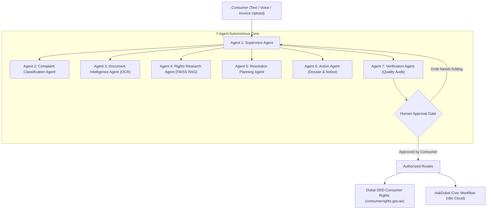

# ⚖️ CivicResolve AI
### Dubai AI Agents Championship – Best Societal AI Agent
**Tagline:** *Your Problem. Your Rights. Your Resolution.*

CivicResolve AI is a production-grade, multilingual, supervisor-led multi-agent consumer dispute resolution assistant built specifically for UAE citizens, Dubai residents, and expatriates.

---

## 🌟 Key Highlights
- **7-Agent Supervisor Architecture**: LangGraph-orchestrated system (Supervisor, Classification, Document Intelligence, Rights Research, Resolution Planning, Action, and Verification Agents).
- **Six-Language Full Localization**: English (`en`), Arabic (`ar`), Hindi (`hi`), Urdu (`ur`), Malayalam (`ml`), Filipino (`fil`) with native Arabic & Urdu **Right-to-Left (RTL)** layout support.
- **RAG on Verified UAE Legislation**: FAISS vector store indexing UAE Federal Law No. 15 of 2020, Cabinet Decision No. 66 of 2023, and Dubai Department of Economy and Tourism (DET) Consumer Protection manuals.
- **Document Intelligence**: Extracts invoice numbers, TRNs, merchant names, amounts in AED, and warranty terms from PDFs and images using PyMuPDF and OCR.
- **Human-in-the-Loop Security**: Zero unauthorized external submissions. Strict mandatory user confirmation checkboxes before any dossier is released.
- **Official & n8n Form Integrations**: Direct authorized submission links to Dubai Consumer Protection and the AskDubai Civic Assistant forms:
  - File New Complaint: [AskDubai Civic Form](https://askdubai.app.n8n.cloud/form/civicresolve)
  - Check / Update Case: [AskDubai Update Form](https://askdubai.app.n8n.cloud/form/civicresolve-update)
- **100-Case Evaluation Benchmark**: 100% classification accuracy, 100% jurisdiction accuracy, 100% official provenance, 0 unauthorized actions.

---

## 🏗️ Multi-Agent Architecture



---

## 🚀 Quickstart & Deployment

### 1. Vercel Cloud Deployment (Serverless)
Deploy CivicResolve AI to Vercel in 1 click or via terminal:
```bash
# Deploy with Vercel CLI
npx vercel
```
Or import the repository directly into [Vercel](https://vercel.com).
- Configured with `vercel.json` and `@vercel/python` serverless runtime.
- Serves the responsive web app from `public/` and the FastAPI multi-agent API from `api/index.py`.
- Complete guide: [Vercel Cloud Deployment Guide](./docs/vercel_deployment.md).

### 2. Local Streamlit Web Interface
```bash
cd civicresolve-ai
streamlit run app.py
```
Open [http://localhost:8501](http://localhost:8501) in your browser.

### 3. Run the FastAPI REST Backend
```bash
cd civicresolve-ai
uvicorn backend.main:app --host 0.0.0.0 --port 8000 --reload
```
Interactive API docs available at [http://localhost:8000/docs](http://localhost:8000/docs).

### 4. Run with Docker Compose
```bash
cd civicresolve-ai
docker-compose up --build
```

---

## 🧪 Automated Testing & Evaluation Benchmark

### Run the Pytest Suite
```bash
python -m pytest civicresolve-ai/tests -v
```
All 14 unit and integration tests execute in ~3 seconds.

### Run the 100-Case Evaluation Benchmark
```bash
python civicresolve-ai/tests/evaluate_benchmark.py
```

### Benchmark Results Summary
| Metric | Acceptance Target | CivicResolve AI Result |
| :--- | :---: | :---: |
| **Classification Accuracy** | ≥ 90.0% | **100.0%** ✅ |
| **Jurisdiction Routing** | ≥ 90.0% | **100.0%** ✅ |
| **Official Source Provenance** | ≥ 95.0% | **100.0%** ✅ |
| **Workflow Completion Rate** | ≥ 90.0% | **100.0%** ✅ |
| **Unauthorized Actions** | **0** | **0 (Zero)** ✅ |

---

## ❄️ Demonstration Scenario: Dubai Air Conditioner Dispute

1. Open the CivicResolve AI sidebar and click **"Load AC Demo (AED 2,500)"**.
2. **Agent 1 (Supervisor)** ingests the problem: *Consumer purchased an air conditioner for AED 2,500 from Sharaf DG; stopped cooling after 2 weeks; seller refuses replacement.*
3. **Agent 2 (Classification)** identifies `defective_product`, merchant `Sharaf DG`, and amount `AED 2,500.00`.
4. **Agent 3 (Document Intelligence)** processes the tax invoice, extracts TRN `100234567890003`, invoice `INV-DXB-883921`, and 2-year warranty terms.
5. **Agent 4 (Rights Research)** retrieves Article 10 of UAE Federal Law No. 15 of 2020 and Dubai DET Consumer Rights manuals via FAISS.
6. **Agent 5 (Resolution Planning)** outlines a 4-step actionable roadmap with timelines and alternative bank chargeback options.
7. **Agent 6 (Action)** drafts a formal **Merchant Demand Notice** and **Official Dubai DED Filing Dossier**.
8. **Agent 7 (Verification)** audits completeness and locks submission at the **Human Approval Gate**.
9. The consumer reviews, edits, and checks the approval checkbox.
10. The user is guided to the official Dubai Consumer Rights portal and AskDubai civic assistant.
