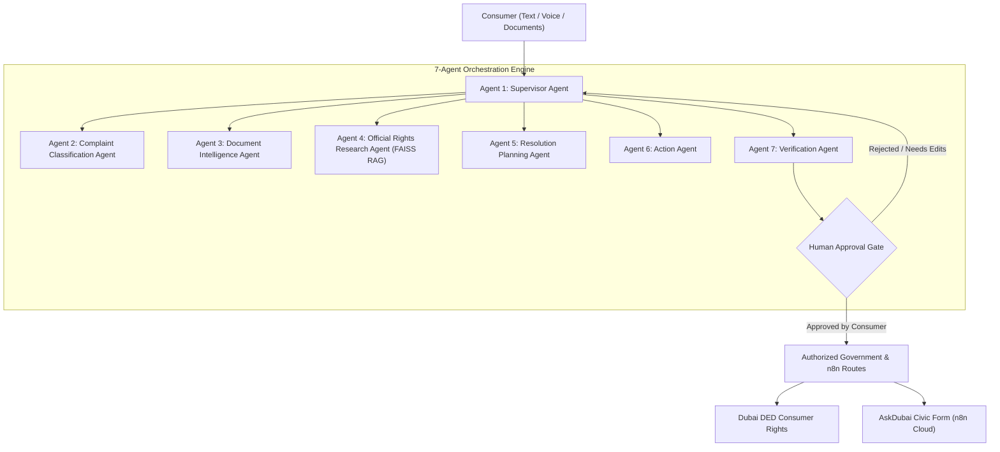

# CivicResolve AI - Multi-Agent Architecture Specification

## 1. Executive Overview
CivicResolve AI is a production-grade, societal-impact AI assistant designed for Dubai and UAE consumers. It replaces fragmented chatbots with an autonomous, supervisor-led multi-agent system that digests consumer grievances, audits documentary evidence (invoices, warranties), retrieves official legislative statutes, crafts formal merchant demand letters, and formats dispute dossiers for official government portals.

## 2. Multi-Agent Ecosystem (7 Specialized Agents)

### Agent Responsibilities
1. **Supervisor Agent (Agent 1)**: Central coordinator managing execution states, coordinating specialist tasks, and halting actions at the Human Approval Gate.
2. **Complaint Classification Agent (Agent 2)**: Classifies grievance into 9 statutory categories and extracts merchant, date, amount, and requested remedy.
3. **Document Intelligence Agent (Agent 3)**: Extracts text from PDFs and images via PyMuPDF/OCR, normalizes TRNs and invoice numbers, and cross-audits stated facts against document text.
4. **Official Rights Research Agent (Agent 4)**: Vector searches FAISS index of verified UAE laws (Federal Law No. 15 of 2020) and Dubai DET manuals, enforcing 100% official provenance.
5. **Resolution Planning Agent (Agent 5)**: Synthesizes a structured 4-step consumer resolution roadmap, detailing facts, evidence gaps, lead authorities, and alternative remedies.
6. **Action Agent (Agent 6)**: Produces formal merchant demand notices, official consumer complaint dossiers, and integration links.
7. **Verification Agent (Agent 7)**: Acts as the quality-assurance safety guardian, scoring factual accuracy, source relevance, and strictly prohibiting autonomous dispatch.

## 3. Technology Stack
- **Frontend**: Streamlit with responsive custom CSS and RTL stylesheet engine for Arabic and Urdu.
- **Backend**: FastAPI, Pydantic, SQLAlchemy ORM, SQLite / PostgreSQL.
- **AI Orchestration**: LangGraph StateGraph, Ollama (Qwen2.5 / Llama3) with deterministic semantic reasoning fallback.
- **RAG & Vector Database**: FAISS (IndexFlatIP), 384-dimensional dense semantic feature embeddings.
- **Document Intelligence**: PyMuPDF (fitz), Pillow, Tesseract OCR.
